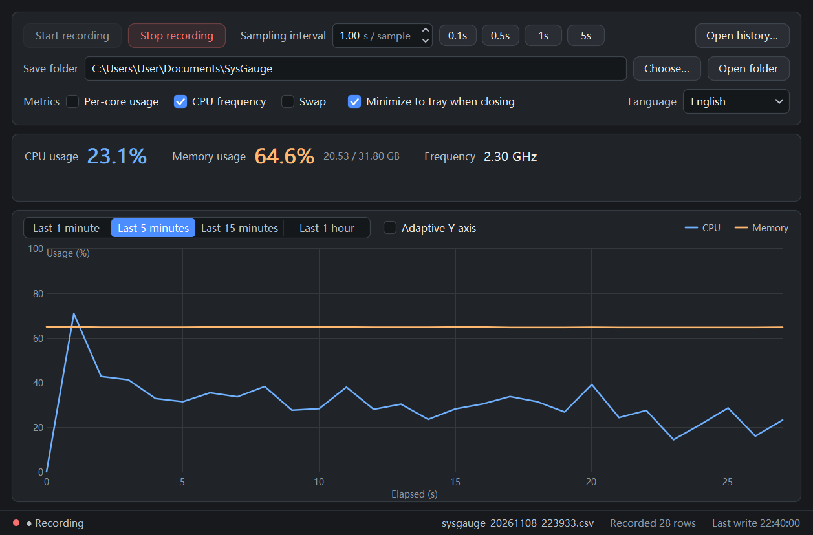
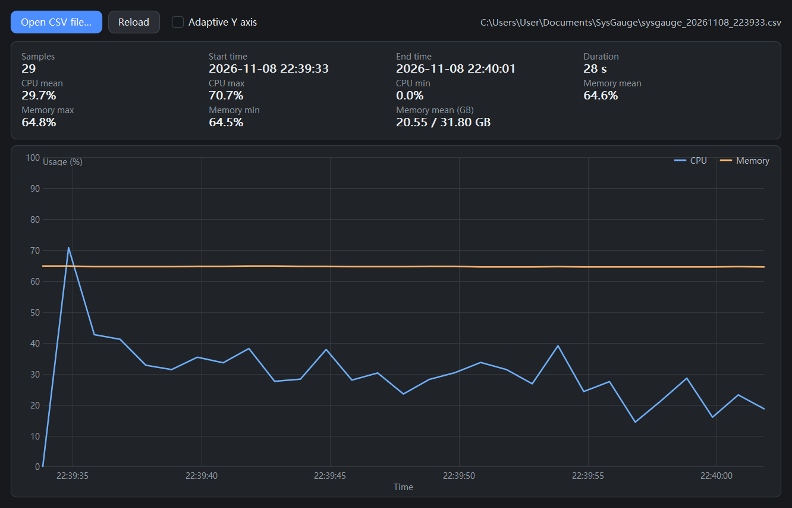

# SysGauge

**English** · [简体中文](README.zh-CN.md)

> A lightweight, reliable Windows CPU / memory usage recorder: real-time charts plus line-by-line CSV logging.


SysGauge samples CPU and memory metrics straight from the Windows API (`GetSystemTimes`, `NtQuerySystemInformation`, `GlobalMemoryStatusEx`, `CallNtPowerInformation`, `GetPerformanceInfo`), draws the charts with a plain Win32 window and GDI, and runs `flush + fsync` after every sample when writing CSV. No Qt, no WebView2, no CGO — a single executable built for long recording sessions, stutter investigations, and performance test reports.

## Screenshots





## Features

- **Real-time charts**: CPU and memory curves with 1-minute / 5-minute / 15-minute / 1-hour display windows.
- **Precise sampling**: Interval adjustable from 0.1 s to 60 s, with 0.1 / 0.5 / 1 / 5 s presets; absolute-time scheduling avoids drift during long runs.
- **Power-loss safe**: Append-only writes, `flush + fsync` after every line; a crash or power loss can damage at most the last line, keeping earlier data intact.
- **Optional metrics**: Per-core usage, CPU frequency, and swap; when disabled, the corresponding CSV columns stay empty.
- **Automatic rotation**: Once a file reaches the threshold (100 MB by default), a new `_partN` file is created; rotation can be disabled.
- **History viewer**: Load a CSV to plot curves and show sample count, time range, and CPU / memory mean, min, and max; truncated lines from power loss are skipped automatically.
- **Chart interaction**: Y axis locked to 0–100; wheel to zoom, drag to pan, double-click to reset. With "Adaptive Y axis" enabled, the axis fits the visible data range and marks extremes with dashed lines.
- **Hover readout**: Both live and history charts show a vertical guide line and the CPU / memory values at that moment.
- **Tray resident**: Closing the window minimizes to the tray and recording continues; the tray icon color follows CPU usage.
- **Single instance**: Launching again activates the existing window, preventing multiple instances from writing at once; the named pipe used by the Python edition is honored too.
- **Light/dark adaptive**: The custom-drawn interface follows the Windows app mode and switches live when the system theme changes.
- **Multi-language UI**: English, 简体中文, 日本語, Deutsch, and Español. Switch from the main window; the choice is saved and follows the system language on first run.

## Requirements

- Windows 10 / 11 (x64)
- Go 1.22 or newer (build time only; the exe needs no runtime)

## Quick Start

```powershell
git clone https://github.com/qepan0520/SysGauge-Go.git
cd SysGauge-Go

go run .
```

> The repository ships `rsrc.syso` (application icon + manifest + DPI awareness), so no extra tools are required to build.

## Usage

1. Click **Start recording**; the app creates `sysgauge_YYYYMMDD_HHMMSS.csv` in the save directory and starts writing.
2. Adjust the interval with **Sampling interval**; changes take effect immediately while running.
3. Choose metrics under **Metrics**; unselected metrics are not sampled and their CSV columns are written empty, keeping the schema unchanged.
4. Click **Stop recording** to end the session and make sure data is flushed.
5. Closing the window **minimizes to tray** by default and recording continues; choose **Quit** in the tray menu to actually exit the process.
6. Click **Open history…** to select an existing CSV and inspect curves and summary statistics. A file can also be opened from the command line:
   `SysGauge.exe D:\path\to\sysgauge_20261108_203540.csv`

### Chart mouse controls

| Action | Effect |
| --- | --- |
| Wheel | Zoom the time axis |
| Left drag | Pan horizontally |
| Hover | Show a guide line and values at that moment |
| Double-click | Return to live follow / full range |
| "Adaptive Y axis" | Fit the axis to the visible valley and peak |

## Data files

### Locations

| Item | Default path |
| --- | --- |
| CSV data | `%USERPROFILE%\Documents\SysGauge\` (changeable in the UI) |
| App config | `%APPDATA%\SysGauge\config.json` |
| Runtime log | `%APPDATA%\SysGauge\logs\sysgauge.log` (1 MB per file, 3 kept) |

### Naming and rotation

- Each **Start recording** creates a new file: `sysgauge_YYYYMMDD_HHMMSS.csv`
- After the rotation threshold: `sysgauge_YYYYMMDD_HHMMSS_part2.csv`, `_part3.csv`, …
- At a 1 s interval a row is roughly 0.1 KB; 100 MB holds about 11 days of data. Adjust or disable rotation in the config.

### CSV columns

| Column | Type | Description |
| --- | --- | --- |
| `timestamp_iso` | ISO 8601 | Local time with millisecond precision |
| `timestamp_unix_ms` | int | Unix timestamp in milliseconds, handy for sorting and math |
| `cpu_percent` | float | Overall CPU usage (0–100) |
| `cpu_percent_cores` | string | Per-core usage separated by `\|`; empty when disabled |
| `cpu_freq_mhz` | float | Current CPU frequency (MHz); empty when unavailable |
| `mem_percent` | float | Physical memory usage (0–100) |
| `mem_used_bytes` | int | Used physical memory in bytes |
| `mem_available_bytes` | int | Available physical memory in bytes |
| `mem_total_bytes` | int | Total physical memory in bytes |
| `swap_percent` | float | Swap usage; empty when disabled |
| `swap_used_bytes` | int | Used swap in bytes; empty when disabled |
| `swap_total_bytes` | int | Total swap in bytes; empty when disabled |

Memory is stored in bytes to avoid rounding errors; divide by `1024^3` in Excel to get GB.

## Build an EXE

```powershell
go build -ldflags "-H windowsgui -s -w" -o SysGauge.exe .
```

Produces a single `SysGauge.exe` with no console window. The icon, manifest, and DPI awareness are embedded from `rsrc.syso`; to regenerate them:

```powershell
rsrc -manifest assets/app.manifest -ico assets/sysgauge.ico -o rsrc.syso -arch amd64
```

> When publishing a GitHub Release, upload `SysGauge.exe` as a release asset. `*.exe` is already in `.gitignore` and should not be committed.

## Project structure

```text
SysGauge-Go/
├── main.go                # Entry point: logging, single instance, wiring
├── internal/
│   ├── app/               # Rolling log, single-instance mutex and activation
│   ├── config/            # Config read/write and validation (same format as Python)
│   ├── metrics/           # Windows metric collection and CSV column definitions
│   ├── recorder/          # CSV append, fsync, file rotation
│   ├── sampler/           # Sampling loop (absolute-time scheduling)
│   ├── history/           # CSV parsing and statistics
│   ├── i18n/              # UI strings and language switching
│   ├── ui/                # Main window, history window, chart, tray, widgets
│   └── win32/             # User32 / GDI32 / Shell32 bindings and AA drawing
├── assets/                # App icons and manifest
├── docs/screenshots/      # README screenshots
├── rsrc.syso              # Icon / manifest resources embedded in the exe
├── go.mod
└── LICENSE
```

## FAQ

**Do I need Python or Go installed to run it?**

No. Use the release `SysGauge.exe` — it is a single native binary with no runtime dependencies. Go is only needed to build from source.

**Does high-frequency sampling hurt performance?**

Every row is `fsync`ed; below 0.5 s the disk I/O overhead grows noticeably, and the UI warns you about it.

**The app keeps running after I close the window?**

That is the default tray behavior and recording continues. Choose **Quit** in the tray menu, or uncheck "Minimize to tray when closing".

**The last line of a history file is incomplete?**

A power loss or a forced kill can damage the last line only. The history window skips malformed rows automatically and reports how many were skipped.

**Why can't the data directory be opened or written?**

The app checks directory writability; if it is not writable, it falls back to `%USERPROFILE%\Documents\SysGauge` and shows a notice.

**How is this different from the Python edition?**

The UI, CSV files, and `config.json` are fully compatible. The Go edition starts faster, keeps a lower memory footprint, and ships as a ~4 MB executable without a Python runtime.

## Privacy

All data stays on your machine. The app does not access the network or upload anything.

## License

Released under the [MIT License](LICENSE).
