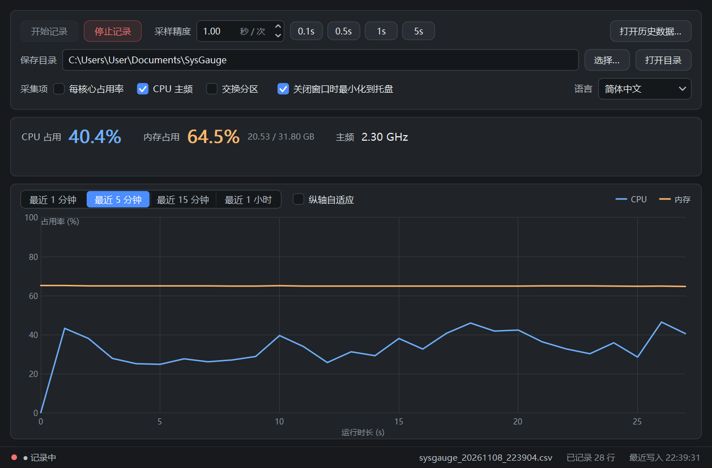
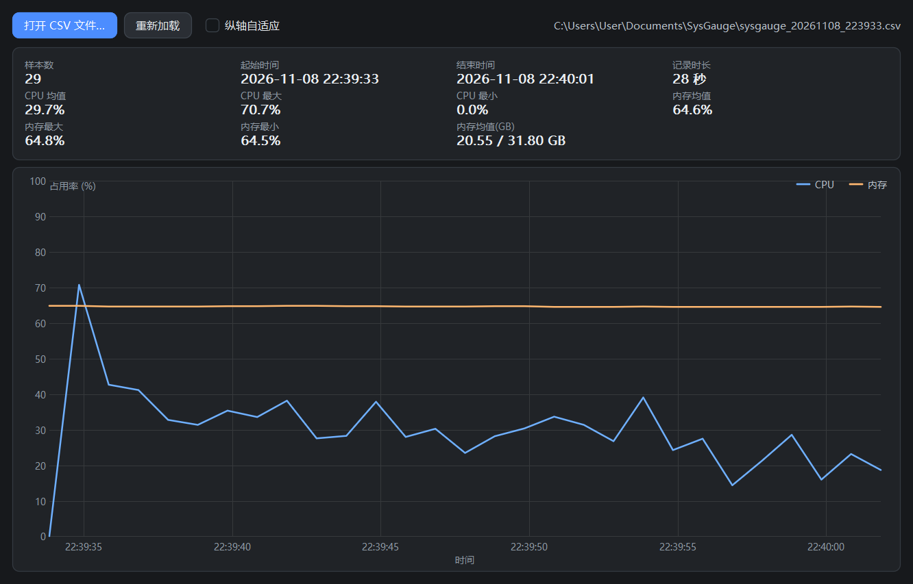

# SysGauge

[English](README.md) · **简体中文**

> 轻量、可靠的 Windows CPU / 内存占用记录工具：实时曲线 + 逐行落盘的 CSV。


SysGauge 直接调用 Windows API（`GetSystemTimes`、`NtQuerySystemInformation`、`GlobalMemoryStatusEx`、`CallNtPowerInformation`、`GetPerformanceInfo`）采集 CPU 与内存指标，使用纯 Win32 窗口 + GDI 绘制实时曲线，并在每次采样后立即 `flush + fsync` 写入 CSV。不依赖 Qt、WebView2 与 CGO，单文件 exe 即可运行，适合长时间记录、排查卡顿、制作性能测试报告。

## 界面预览





## 功能特性

- **实时曲线**：CPU 与内存双曲线，支持最近 1 分钟 / 5 分钟 / 15 分钟 / 1 小时显示窗口。
- **精确采样**：采样间隔 0.1 s ~ 60 s 可调，提供 0.1 / 0.5 / 1 / 5 s 快捷预设；采用绝对时间点调度，长时间运行不累积漂移。
- **断电安全**：只追加不修改，每写一行立即 `flush + fsync`；崩溃或断电最多损坏最后一行，历史数据保持完好。
- **可选采集项**：每核心占用率、CPU 主频、交换分区，按需开启，不开启时 CSV 对应列留空。
- **自动切分**：单个文件达到阈值（默认 100 MB）后自动新建 `_partN` 文件，可设为不切分。
- **历史回看**：载入 CSV 绘制曲线，并给出样本数、时间范围、CPU / 内存均值与最大最小值；自动跳过断电导致的残缺行。
- **图表交互**：纵轴锁定 0 ~ 100；滚轮缩放时间轴、左键拖拽平移、双击复位。开启「纵轴自适应」后，纵轴贴合可见数据的谷值与峰值并画虚线标记。
- **悬停读数**：实时与历史图表均支持鼠标悬停，显示竖线与该时刻的 CPU / 内存数值。
- **托盘常驻**：关闭窗口默认最小化到托盘继续记录；托盘图标颜色随 CPU 占用率变化。
- **单实例运行**：重复启动会激活已有窗口，避免多个实例同时写数据；同时兼容 Python 版使用的命名管道。
- **明暗主题自适应**：界面跟随 Windows 的深色 / 浅色模式，系统主题切换后立即生效，无需重启。
- **多语言界面**：支持英文、简体中文、日本語、Deutsch、Español，主窗口内即可切换；选择会被记住，首次启动跟随系统语言。

## 环境要求

- Windows 10 / 11（x64）
- Go 1.22 或更高（仅构建时需要；运行 exe 不需要安装任何运行时）

## 快速开始

```powershell
git clone https://github.com/qepan0520/SysGauge-Go.git
cd SysGauge-Go

go run .
```

> 仓库已包含 `rsrc.syso`（应用图标 + 清单 + DPI 感知），无需额外工具即可构建。

## 使用说明

1. 点击 **开始记录**，程序会在保存目录新建 `sysgauge_YYYYMMDD_HHMMSS.csv` 并开始写入。
2. 通过 **采样精度** 调整记录间隔；运行中修改立即生效。
3. 通过 **采集项** 勾选需要的指标；未勾选的指标不采集，CSV 对应列写入空值，表结构保持不变。
4. 点击 **停止记录** 结束本次会话并确保数据刷盘。
5. 关闭窗口默认**最小化到托盘**，记录继续进行；在托盘菜单中选择「退出」才会真正结束进程。
6. 点击 **打开历史数据…** 选择已有 CSV，查看曲线与统计摘要；也可以通过命令行直接打开：
   `SysGauge.exe D:\path\to\sysgauge_20261108_203540.csv`

### 图表鼠标操作

| 操作 | 效果 |
| --- | --- |
| 滚轮 | 横向缩放时间轴 |
| 左键拖拽 | 横向平移 |
| 鼠标悬停 | 显示竖线与该时刻读数 |
| 双击 | 回到实时跟随 / 完整范围 |
| 勾选「纵轴自适应」 | 纵轴贴合可见数据的谷值与峰值 |

## 数据文件

### 保存位置

| 内容 | 默认路径 |
| --- | --- |
| CSV 数据 | `%USERPROFILE%\Documents\SysGauge\`（可在界面中修改） |
| 应用配置 | `%APPDATA%\SysGauge\config.json` |
| 运行日志 | `%APPDATA%\SysGauge\logs\sysgauge.log`（单文件 1 MB，保留 3 份） |

### 文件命名与切分

- 每次「开始记录」新建一个文件：`sysgauge_YYYYMMDD_HHMMSS.csv`
- 达到切分阈值后：`sysgauge_YYYYMMDD_HHMMSS_part2.csv`、`_part3.csv` ……
- 采样间隔 1 s 时约 0.1 KB/行，100 MB 约可记录 11 天；可在配置中调整或关闭切分。

### CSV 列说明

| 列名 | 类型 | 说明 |
| --- | --- | --- |
| `timestamp_iso` | ISO 8601 | 本地时间，毫秒精度 |
| `timestamp_unix_ms` | int | Unix 毫秒时间戳，便于排序与计算 |
| `cpu_percent` | float | 整机 CPU 占用率（0 ~ 100） |
| `cpu_percent_cores` | string | 每核心占用率，以 `\|` 分隔；未开启时为空 |
| `cpu_freq_mhz` | float | 当前 CPU 主频（MHz）；不可用时为空 |
| `mem_percent` | float | 物理内存占用率（0 ~ 100） |
| `mem_used_bytes` | int | 已用物理内存（字节） |
| `mem_available_bytes` | int | 可用物理内存（字节） |
| `mem_total_bytes` | int | 物理内存总量（字节） |
| `swap_percent` | float | 交换分区占用率；未开启时为空 |
| `swap_used_bytes` | int | 已用交换分区（字节）；未开启时为空 |
| `swap_total_bytes` | int | 交换分区总量（字节）；未开启时为空 |

内存统一以字节存储，避免舍入误差；在 Excel 中除以 `1024^3` 即可换算为 GB。

## 打包为 EXE

```powershell
go build -ldflags "-H windowsgui -s -w" -o SysGauge.exe .
```

生成单文件 `SysGauge.exe`（无控制台窗口）。图标、清单与 DPI 感知已打包进 `rsrc.syso`，如需重新生成：

```powershell
rsrc -manifest assets/app.manifest -ico assets/sysgauge.ico -o rsrc.syso -arch amd64
```

> 发布 GitHub Release 时，可将 `SysGauge.exe` 作为 Release 附件上传；`*.exe` 已加入 `.gitignore`，无需提交进仓库。

## 项目结构

```text
SysGauge-Go/
├── main.go                # 程序入口：日志、单实例、装配
├── internal/
│   ├── app/               # 滚动日志、单实例互斥与激活
│   ├── config/            # 配置读写与校验（与 Python 版同格式）
│   ├── metrics/           # Windows 指标采集与 CSV 列定义
│   ├── recorder/          # CSV 追加写入、fsync、文件切分
│   ├── sampler/           # 采样循环（绝对时间点调度）
│   ├── history/           # CSV 容错解析与统计
│   ├── i18n/              # 界面文案与语言切换
│   ├── ui/                # 主窗口、历史窗口、图表、托盘、自绘控件
│   └── win32/             # User32 / GDI32 / Shell32 绑定与抗锯齿绘制
├── assets/                # 应用图标与清单
├── docs/screenshots/      # README 截图
├── rsrc.syso              # 打包进 exe 的图标 / 清单资源
├── go.mod
└── LICENSE
```

## 常见问题

**运行需要安装 Python 或 Go 吗？**

不需要。直接使用 Release 中的 `SysGauge.exe`，它是无运行时依赖的原生单文件程序；Go 仅在从源码构建时需要。

**高频采样会影响性能吗？**

每行数据都会执行 `fsync`，采样间隔低于 0.5 s 时磁盘 I/O 会明显增加，界面会给出提示。

**关闭窗口后程序还在运行？**

这是默认的托盘驻留行为，记录不会中断。可在托盘菜单中选择「退出」，或取消勾选「关闭窗口时最小化到托盘」。

**历史文件最后一行不完整？**

断电或强制结束进程时可能只损坏最后一行。历史数据窗口会自动跳过异常行，并在界面上提示跳过数量。

**为什么数据目录打不开 / 无法写入？**

程序会检查目录可写性；不可写时会回落到默认目录 `%USERPROFILE%\Documents\SysGauge`，并给出提示。

**与 Python 版有什么区别？**

界面、CSV 文件与 `config.json` 完全兼容；Go 版启动更快、常驻内存更低，约 4 MB 的单文件 exe，无需 Python 运行时。

## 隐私

所有数据仅保存在本机。程序不联网，不上传任何信息。

## 许可证

本项目基于 [MIT License](LICENSE) 开源。
